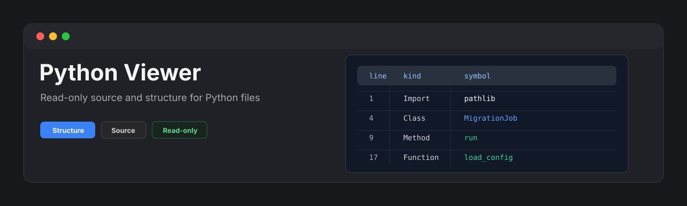
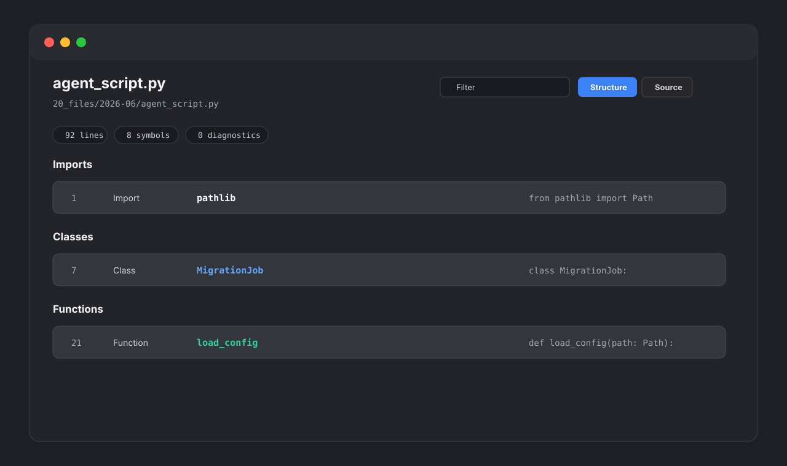

<p align="center">
  
</p>

<p align="center">
  <a href="https://github.com/viggomeesters/obsidian-python-viewer/releases/latest"></a>
  <a href="LICENSE"></a>
  
  
</p>

# Python Viewer

Python Viewer is a read-only plugin for browsing `.py` files as source plus a compact structure outline. It is built for quick inspection of scripts, generated code, migration utilities, and agent output without turning the vault into an IDE.



## Features

- Opens `.py` files in a dedicated view.
- Shows a structure view with imports, decorators, classes, functions, methods, and top-level constants.
- Provides a source view with line numbers and lightweight Python syntax highlighting.
- Filters symbols and source lines by name, kind, detail, and source text.
- Jumps from a symbol to its source line.
- Reports parse diagnostics such as missing colons on `def` or `class` lines.
- Keeps source view available when structure parsing is incomplete.
- Applies a 10,000 line render cap to keep large generated scripts responsive.
- Stays read-only by design: it never writes back to Python files and never runs Python code.

## Why read-only?

This plugin is for inspection. It does not execute code, start subprocesses, lint, format, refactor, sort imports, or save changes. Editing and execution belong in a code editor or terminal where project context, environments, and safeguards are explicit.

## Parser strategy

Python Viewer v0.1 uses a lightweight local symbol parser. It detects common imports, decorators, classes, functions, methods, and top-level constants while avoiding detections inside comments and triple-quoted strings. It is intentionally not a full Python AST parser.

When parsing is incomplete or a syntax diagnostic is found, the source view remains available and line numbers are preserved.

## Large files

Python files can become large when generated by agents or migration tooling. Python Viewer renders the first 10,000 lines and reports how many lines were skipped.

## Privacy and security

Python Viewer does not make network requests and does not send vault content to external services. It does not use the system clipboard, does not write files, and does not execute Python code.

## Installation

### Community plugin directory

Python Viewer is ready for Community plugin directory submission. Once accepted, it can be installed from **Settings -> Community plugins -> Browse**.

### Manual installation

Until the community directory submission is accepted:

1. Download `main.js`, `manifest.json`, and `styles.css` from the [latest release](https://github.com/viggomeesters/obsidian-python-viewer/releases/latest).
2. Create this folder in your vault: `.obsidian/plugins/python-viewer/`.
3. Put the downloaded files in that folder.
4. Reload the app.
5. Enable **Python Viewer** in **Settings -> Community plugins**.

### BRAT installation

For beta testing, install the plugin with [BRAT](https://github.com/TfTHacker/obsidian42-brat) using this repository URL:

```text
https://github.com/viggomeesters/obsidian-python-viewer
```

## Usage

Open any `.py` file in your vault. The file opens with Python Viewer.

Use the toolbar to:

- filter symbols and source lines
- switch between Structure and Source views
- refresh the file after external changes

## Development

```bash
npm install
npm run build
npx tsc --noEmit
npm test
```

## Release files

The runtime files are:

- `main.js`
- `manifest.json`
- `styles.css`

## Release process

Community plugin files are installed from GitHub releases. For each release:

1. Update `manifest.json`, `package.json`, and `versions.json`.
2. Run `npm install`, `npm run build`, `npx tsc --noEmit`, and `npm test`.
3. Create a GitHub release whose tag exactly matches `manifest.json.version`.
4. Attach `main.js`, `manifest.json`, and `styles.css` as release assets.

The repository includes a GitHub Actions release workflow with artifact attestation support. If GitHub Actions is disabled for the owner account, manual releases are still usable, but automated review may show a recommendation about missing artifact attestations.

## Community directory submission

The repository is prepared for Community plugin submission. The remaining submission step must be completed by the repository owner because it requires signing in, linking GitHub, and confirming the developer policies/support commitment.

Submit this repository URL:

```text
https://github.com/viggomeesters/obsidian-python-viewer
```

Steps:

1. Sign in to [community.obsidian.md](https://community.obsidian.md).
2. Link the GitHub account that owns this repository.
3. Open **Plugins -> New plugin**.
4. Enter the repository URL above.
5. Confirm the developer policies and submit.
6. Address any automated review feedback.

The current release is ready for review:

- root `README.md`, `LICENSE`, and `manifest.json` exist
- `manifest.json.version` is `0.1.0`
- GitHub release `0.1.0` exists
- release assets include `main.js`, `manifest.json`, and `styles.css`
- `versions.json` maps supported app versions

Official references:

- [Submit your plugin](https://docs.obsidian.md/Plugins/Releasing/Submit%20your%20plugin)
- [Obsidian releases repository](https://github.com/obsidianmd/obsidian-releases)

## License

[MIT](LICENSE)
